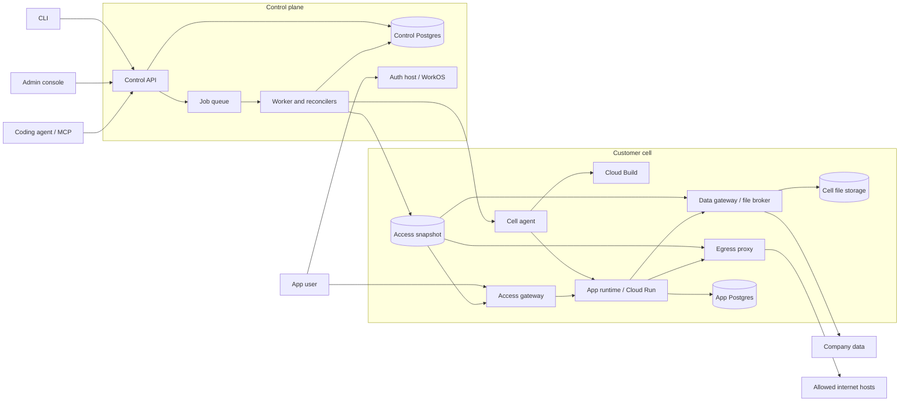

# SSC architecture and packages

SSC separates the control plane from each customer's cell. The control plane owns desired
state and policy; cell services carry out builds, runtime changes, and access checks in the
customer's Google Cloud project. The [decision records](decisions/README.md) and
[infrastructure guide](../infra/README.md) hold the detailed design and deployment configuration.

## Components

This diagram shows responsibilities and request paths. The queue is backed by control-plane
Postgres; the access snapshot is stored in the cell's bucket. A cell has its own project,
network, gateway, and outbound IP. Its database, data gateway, and egress proxy are added on
demand; the infrastructure guide describes each resource's lifecycle.

App access is decided from the published snapshot. The gateway passes an
[`X-SSC-Identity` note](contracts/identity-note.md) to the app, which verifies it through a
Python or Node helper. App runtime internet access uses the organisation's proxy allowlist.
[Builds use a separate network policy](trust/build-limits.md); the runtime boundary does not
describe build egress.

## Python workspace

The root uv workspace includes `packages/*` and `conformance`. Product packages follow
`packages/<package>/src/<module>/`, with package-local tests. The root
[pyproject.toml](../pyproject.toml) defines workspace dependencies and import rules.

| Package | Responsibility |
| --- | --- |
| [ssc_contracts](../packages/ssc_contracts/) | Wire and storage models: manifests, capabilities, app environment names, identity notes, access snapshots, and the error catalog. |
| [ssc_shared](../packages/ssc_shared/) | Canonical digests, clock, the shared access evaluator, blob-store protocols and implementations, and runtime/build protocols. |
| [ssc_bundle](../packages/ssc_bundle/) | Build and scan the source bundle uploaded by `ssc deploy`. |
| [ssc_control](../packages/ssc_control/) | FastAPI control API, org-scoped database, identity, policy, jobs, and reconcilers. |
| [ssc_agent](../packages/ssc_agent/) | Cell-local operations for Cloud Build, Cloud Run, databases, files, secret intake, logs, and usage. |
| [ssc_edge](../packages/ssc_edge/) | Cell gateway authorization, login integration, identity-note issuance, and schedule-token verification. |
| [ssc_datagw](../packages/ssc_datagw/) | Read-only company data connectors and the file broker, with snapshot admission and limits. |
| [ssc_egress](../packages/ssc_egress/) | Egress proxy configuration and snapshot-driven allowlists. |
| [ssc_cli](../packages/ssc_cli/) | The `ssc` command, deployment workflow, agent pack, and local MCP interface. |
| [ssc_app](../packages/ssc_app/README.md) | Python app helpers for identity, reconnecting streams, workload tokens, files, and data. |
| [ssc_landing](../packages/ssc_landing/) | Independent server for the public page and pilot request form. |
| [ssc_console_host](../packages/ssc_console_host/) | Independent server for the built console and its static assets. |

## Control plane code guide

Paths below are relative to
[`packages/ssc_control/src/ssc_control/`](../packages/ssc_control/src/ssc_control/).

| Path | Responsibility |
| --- | --- |
| [api/](../packages/ssc_control/src/ssc_control/api/) | Public `/v1`, internal `/internal/v1`, MCP routes, authentication, authorization, idempotency, and API composition. |
| [db/](../packages/ssc_control/src/ssc_control/db/README.md) | Schema, migrations, roles, org binding, and the schema/privilege/PII catalogs. |
| [domain/](../packages/ssc_control/src/ssc_control/domain/) | Pure approval, sharing, scheduling, and statistics rules. |
| [ports.py](../packages/ssc_control/src/ssc_control/ports.py) | Cross-lane protocols with safe default stubs: production gate, snapshots, timers, and metrics. |
| [worker.py](../packages/ssc_control/src/ssc_control/worker.py) | Procrastinate worker composition and task registration; `worker_ports.py` supplies ports and `deferral.py` enqueues inside the caller's transaction. |
| [deploy/](../packages/ssc_control/src/ssc_control/deploy/) | Bundle intake, build jobs, releases, deployment operations, and production gates. |
| [runtime/](../packages/ssc_control/src/ssc_control/runtime/) | Desired service state, reconciliation, cell-agent drivers, app databases, secrets, logs, and usage. Shared driver protocols live in `ssc_shared`. |
| [snapshot/](../packages/ssc_control/src/ssc_control/snapshot/) | Compile and publish content-addressed access snapshots, track dirty state, and process cell acknowledgements. |
| [identity/](../packages/ssc_control/src/ssc_control/identity/) | Auth host, WorkOS SSO and directory sync, OAuth clients, sessions, and token issuance. |
| [approvals/](../packages/ssc_control/src/ssc_control/approvals/) | Open and decide approval requests, evaluate capabilities, and enforce the production gate. |
| [audit/](../packages/ssc_control/src/ssc_control/audit/) | Hash-chain append, search, export, verification, and cell-bucket anchors. |
| [lifecycle/](../packages/ssc_control/src/ssc_control/lifecycle/) | Kill switch, app enablement, owner changes, and rollback. |
| [cell/](../packages/ssc_control/src/ssc_control/cell/) | Customer cell creation, lazy resources, and warm settings. |
| [connections/](../packages/ssc_control/src/ssc_control/connections/) | Company data connection setup and lifecycle. |
| [github/](../packages/ssc_control/src/ssc_control/github/) | Connected repositories, webhook handling, and push-driven preview builds. |
| [notifications/](../packages/ssc_control/src/ssc_control/notifications/) | Approval email composition and delivery jobs. |
| [timers/](../packages/ssc_control/src/ssc_control/timers/) | Declared schedules, run tracking, dispatch, and signed HTTPS calls to app hosts. |
| [metrics/](../packages/ssc_control/src/ssc_control/metrics/) | Product events, pseudonyms, usage reporting, and pilot criteria. |
| [storage.py](../packages/ssc_control/src/ssc_control/storage.py) | Shared blob-store factory for the API, worker, and operator commands. |

The [API guide](api/README.md) defines response conventions and how to add routes. The
[database guide](../packages/ssc_control/src/ssc_control/db/README.md) explains forced
row-level security and transaction-scoped org binding. Wire contracts are indexed in
[the documentation guide](README.md#architecture-and-contracts).

## Other projects and verification

- [console/](../console/README.md) contains React routes, design tokens, the generated OpenAPI
  client, Vitest tests, and Playwright checks against the API.
- [landing/](../landing/README.md) contains the public HTML page, art source, claims, calculator
  vectors, and browser checks; `ssc_landing` serves it.
- [helpers/node/](../helpers/node/) contains dependency-free identity, reconnect, file, and data
  helpers. Python and Node helpers use shared conformance vectors.
- [conformance/](../conformance/) contains black-box checks, build fixtures, runtime probes,
  and suites implementations of blob-store, build, and runtime ports must pass.
- [e2e/isolation/](../e2e/isolation/README.md) checks org and customer-cell isolation through
  browser and API flows.
- [gates/](../gates/) contains intentional failures that prove lint, typing, import, dependency,
  secret, and API gates work.
- [infra/](../infra/README.md) is a separate Pulumi/uv project; its provider SDK stays outside
  the service workspace.
- [tools/](../tools/) contains the local dev stack, dependency policy checks, OpenAPI checks,
  and release checks. [.github/](../.github/) runs them and hosts the preview deploy action.

## Enforced boundaries

Imports follow the allowed direction: services → `ssc_bundle` → `ssc_shared` → `ssc_contracts`.
Import-linter enforces the layers. Contracts import no SSC implementations. Cell services and `ssc_app` import
neither `ssc_control` nor its database libraries. `ssc_app` is installed into customers' apps, so it imports
no other workspace package and runs on Python 3.11 and later. The public page and console host remain
independent of platform implementations and credentials.

Cross-lane ports import no implementation. The API defers jobs by name and never imports the
worker. Product HTTP clients use `httpx2`; `httpx` is present only for the development test
client. Strict typing covers the modules listed in the root `pyproject.toml`; conformance and
catalog tests check the protocol and storage boundaries.

See [CONTRIBUTING.md](../CONTRIBUTING.md#repository-and-dependency-rules) for the complete
repository rules and [the known limits](README.md#known-limits) for the current pilot scope.
